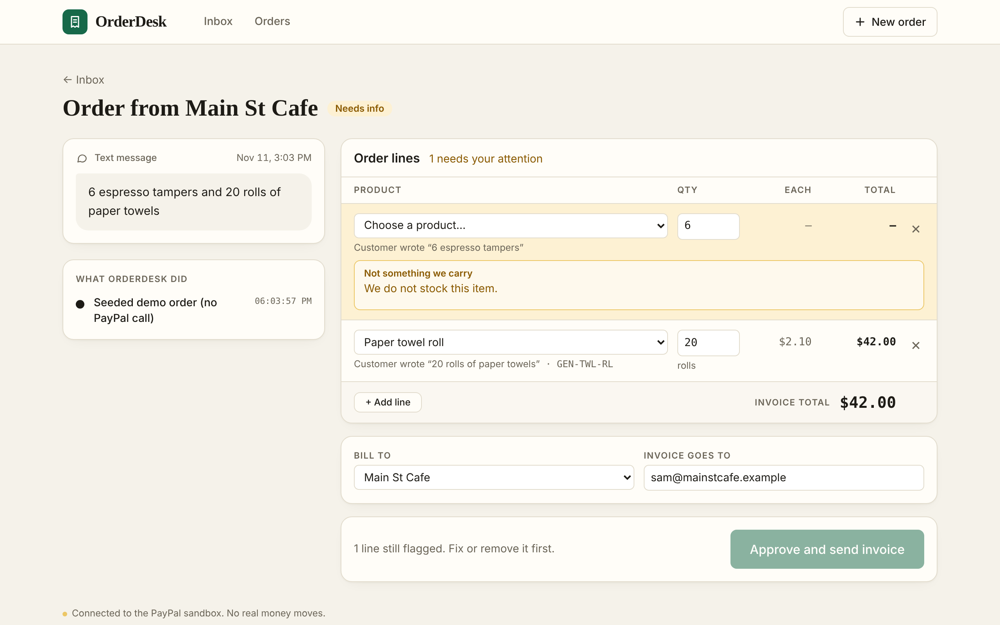
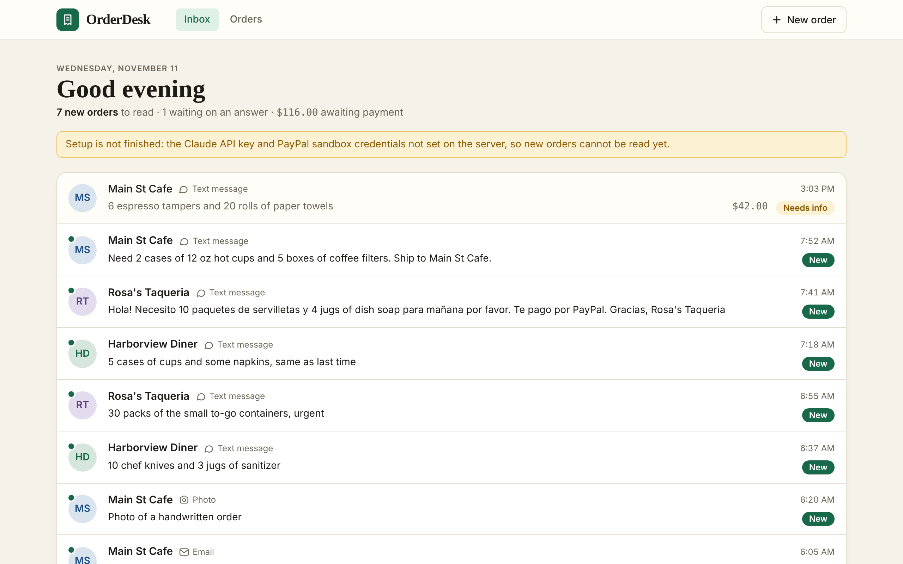
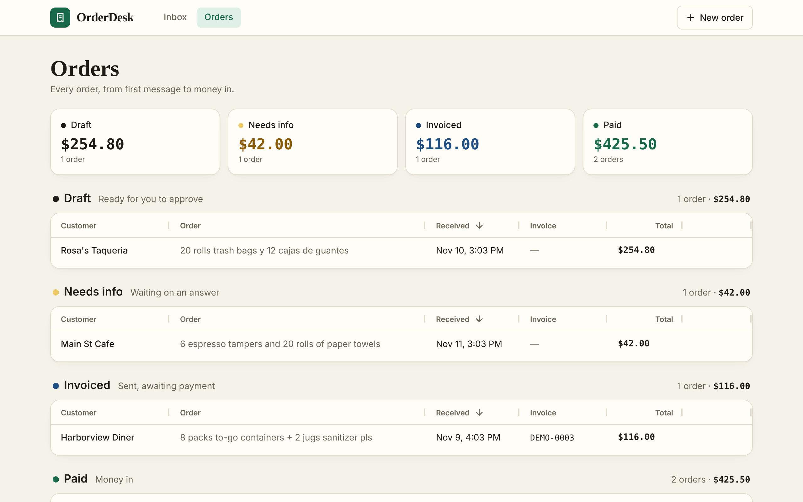
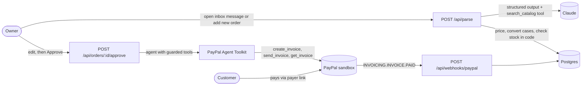

# OrderDesk

**For small distributors: customer orders arrive as messy texts, emails and photos. An AI agent turns each one into a priced PayPal invoice that the owner approves and sends in one tap, then tracks payment.**

Built for the [PayPal AI Hackathon](https://paypalaihackathon.devpost.com/). PayPal sandbox only.

**Live demo:** https://orderdesk-g9ph.onrender.com/ (PayPal sandbox only)



## The problem

Small distributors, like a company that supplies restaurants and cafes, take orders by text, email and handwritten notes. The orders are informal: half English, half Spanish, no SKUs, loose quantities ("Necesito 10 paquetes de servilletas y 4 jugs of dish soap para mañana"). Someone retypes each one into an invoice, then chases the payment. It is daily, error-prone work.

OrderDesk does the retyping and the chasing:

1. **Order in.** Orders land in an inbox as texts, emails and photos, the way they arrived. Phone or paper orders can be pasted on the **New order** page, with an optional photo of a handwritten list.
2. **Agent reads it.** Claude looks up each product in the catalog, converts cases to units, and prices every line. Anything unclear is flagged with the reason, not guessed.
3. **Owner reviews.** Edit lines, fix flags in one click, pick the customer.
4. **Approve.** Only now does an agent, using PayPal's own Agent Toolkit, create and send the invoice.
5. **Paid.** A PayPal webhook marks the order paid. No chasing.

| Inbox | Orders (AG Grid) |
| --- | --- |
|  |  |

## What it handles

The inbox opens with seven sample messages, shown as if they arrived this morning from Rosa's Taqueria, Main St Cafe and Harborview Diner. Each one shows a different behavior:

| Sample | What it shows |
| --- | --- |
| Clean | "2 cases" of cups becomes 40 sleeves using the catalog pack size |
| Spanish/English mix | *servilletas* matched to napkins, *para mañana* becomes the delivery note |
| Ambiguous | "5 cases of cups and some napkins, same as last time": three flags, zero guesses |
| Out of stock | 30 requested, 25 in stock: offers "Send 25 now" |
| Unknown item | Chef knives are not sold: line flagged, the rest priced |
| Handwritten photo | Claude vision reads a photographed list |
| Email forward | Signature and the older quoted order are ignored |

## Architecture

One Next.js app does everything. The only other services are Claude, the PayPal sandbox and Postgres.



### Three decisions that matter

**The model never sets a price.** The parser returns only what the customer asked for: a SKU that `search_catalog` returned, a quantity, and whether it was counted in cases. Names, prices, case sizes and stock are applied in code ([`src/lib/pricing.ts`](src/lib/pricing.ts)). A SKU that is not in the catalog is dropped and the line is flagged, so an invented product or price cannot reach an invoice.

**The approve route is the only path to PayPal.** The parsing agent has one tool, a catalog search. PayPal tools exist only inside `POST /api/orders/[id]/approve`, which refuses any order with a flagged line, a missing quantity or no billing email.

**Approval is enforced in code, not in the prompt.** The invoicing agent's PayPal tools are wrapped in a guard ([`src/lib/approve.ts`](src/lib/approve.ts)). `create_invoice` is rejected before it reaches PayPal unless every line's quantity and unit price, the total, the currency and the recipient match what the owner approved. `send_invoice` only accepts the invoice that was just created. After sending, the invoice total is read back from PayPal and compared again.

### PayPal usage

Through [`@paypal/agent-toolkit`](https://github.com/paypal/agent-toolkit) (sandbox mode, invoice tools only):

| Step | Toolkit tool | Where |
| --- | --- | --- |
| Create draft invoice | `create_invoice` | invoicing agent |
| Send invoice | `send_invoice` | invoicing agent |
| Confirm, read status and payer link | `get_invoice` | invoicing agent, Refresh button |
| Reminder for unpaid | `send_invoice_reminder` | Send reminder button |
| QR code for counter payment | `generate_invoice_qr_code` | QR button |

Called directly: `POST /v1/notifications/verify-webhook-signature` to verify every webhook before it is trusted. Events handled: `INVOICING.INVOICE.PAID`, `INVOICING.INVOICE.CANCELLED`. Every tool call is recorded and shown on the review screen under "What OrderDesk did".

### Stack

| Layer | Choice |
| --- | --- |
| App | Next.js 15 (App Router), TypeScript, Tailwind |
| Agent | Vercel AI SDK with the Anthropic provider, `claude-sonnet-5-5` |
| PayPal | `@paypal/agent-toolkit`, sandbox |
| Database | Postgres (Neon) with Drizzle ORM. Tables: `customers`, `orders`, `order_lines`, `events` |
| Grid | AG Grid Community |
| Hosting | Render web service ([`render.yaml`](render.yaml)) |

## Run it locally

Requires Node 20 or newer.

```bash
git clone https://github.com/jayneel-shah18/PayPal-AI-Hackathon-OrderDesk.git && cd PayPal-AI-Hackathon-OrderDesk
npm run demo
```

`npm run demo` is the one command: it installs dependencies, creates `.env.local` from the template, seeds sample orders and starts the app at http://localhost:3000. The orders page and review screens work straight away. To parse new orders and send invoices, add your keys to `.env.local` (below) and restart.

No database setup is needed locally: with `DATABASE_URL` empty the app uses an embedded Postgres (PGlite) in `./.data`. Tables are created on first start.

### Environment variables

| Variable | Required | What it is |
| --- | --- | --- |
| `ANTHROPIC_API_KEY` | yes | Claude API key |
| `PAYPAL_CLIENT_ID`, `PAYPAL_CLIENT_SECRET` | yes | Sandbox REST app credentials from the [PayPal Developer Dashboard](https://developer.paypal.com/dashboard/applications/sandbox) |
| `PAYPAL_WEBHOOK_ID` | for webhooks | ID of the webhook subscribed to `https://<your-app>/api/webhooks/paypal` |
| `DATABASE_URL` | on Render | Postgres connection string (Neon). Empty means embedded PGlite |
| `PAYPAL_BUYER_EMAIL` | optional | Sandbox personal account email, used as the billing email for the demo customers |
| `PAYPAL_INVOICER_EMAIL` | optional | Sandbox business account email shown as the invoicer |
| `ORDERDESK_MODEL` | optional | Override the model ID |

Secrets live only in `.env.local`, which is gitignored along with every other `.env*` file except the empty `.env.example`. Use sandbox credentials only; the app is hard-wired to the sandbox.

### Check the PayPal round trip first

```bash
npm run paypal:roundtrip -- <sandbox-personal-account-email>
```

Creates, sends and fetches one hard-coded $212.50 invoice, checks the QR endpoint, prints the payer link, then waits until you pay it as the sandbox buyer and PayPal reports it `PAID`.

### Tests

```bash
npm test            # offline: catalog search, pricing, approval guard, agent run with a scripted model, webhook handling
npm run test:live   # the seven sample orders against the real model (needs ANTHROPIC_API_KEY)
npm run typecheck
```

## Deploy to Render

1. Create a free Postgres database on [Neon](https://neon.tech) and copy its connection string.
2. On Render, create a Blueprint from this repo (it reads `render.yaml`) and set the environment variables above.
3. In the PayPal Developer Dashboard, open your sandbox app, add a webhook for `https://<your-app>.onrender.com/api/webhooks/paypal` with the events `Invoicing invoice paid` and `Invoicing invoice cancelled`, and put its ID in `PAYPAL_WEBHOOK_ID`.
4. Optionally run `npm run db:seed` once with `DATABASE_URL` set, to fill the orders page.

To start over with clean demo data, run `npm run db:reset` with `DATABASE_URL` set. It deletes every order and customer in that database, restores the customers from `data/customers.json` and seeds the sample history again.

Free Render services sleep when idle; the first request after a pause takes about a minute.

## How to test (for judges)

1. Open the live URL. The inbox lists this morning's messages. Click a new one, for example the Spanish/English text from **Rosa's Taqueria**.
2. Watch the "What OrderDesk did" panel: each `search_catalog` call appears as the agent works. The review screen fills with priced lines.
3. Back in the inbox, open the **Harborview Diner** message "5 cases of cups and some napkins, same as last time" to see flags. Pick a cup size, enter quantities, then **Approve and send invoice**. To enter your own order, use **New order**.
4. The panel shows `create_invoice`, `send_invoice` and `get_invoice`. Click **Open payer link**.
5. Log in with the sandbox buyer account given in the Devpost submission and pay.
6. Return to **Orders**: the row turns **Paid** when the webhook arrives (or click **Refresh**).

## How AI tools were used

- **In the product:** Claude (`claude-sonnet-5-5`) reads orders with structured output and a catalog search tool, reads handwritten photos with vision, and drives PayPal's Agent Toolkit to create and send invoices.
- **In development:** I designed the product, the architecture and the guardrails (code-enforced approval, the model never setting prices, the approve route as the only path to PayPal), and chose the stack and test cases. I used Claude Code as a coding assistant to implement and iterate on that design, write tests and speed up UI work, reviewing and directing the changes throughout. All code was written after October 1, 2026.

## Notes

- The catalog is a made-up restaurant and cafe supply range. Brands (Harbor, Brightline), customers and prices are invented demo data.
- The demo has no login. It talks only to the PayPal sandbox, so no real money can move.
- The demo video script is in [`docs/demo-script.md`](docs/demo-script.md).
- The sample "handwritten" photo is a rendered stand-in; any phone photo of a handwritten list works the same way.

## License

[MIT](LICENSE)
